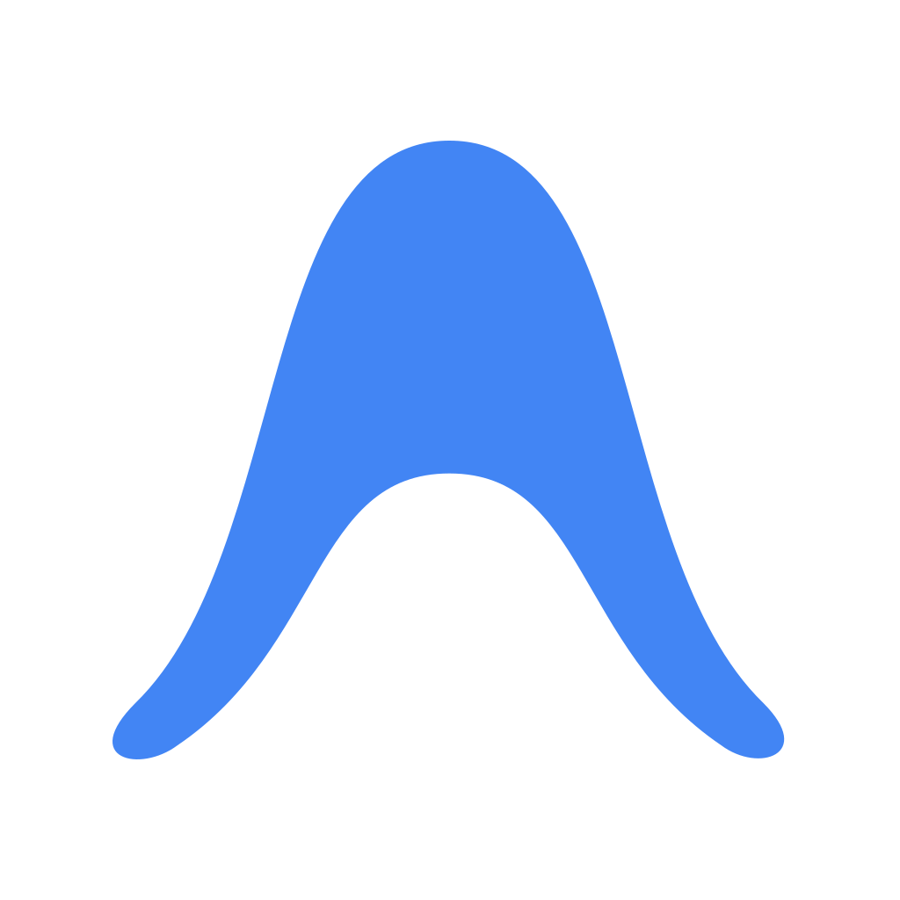

<div align="center">
  
  <h1>Google Antigravity IDE on NixOS</h1>
  <p>Production-grade Nix packaging of Google's agent-first development environment built on VS Code</p>

  <p>
    <a href="https://github.com/B-Shinchan/antigravity-ide-nixos/actions/workflows/ci.yml"></a>
    <a href="https://github.com/B-Shinchan/antigravity-ide-nixos/actions/workflows/update.yml"></a>
    <a href="https://github.com/B-Shinchan/antigravity-ide-nixos/releases"></a>
    <a href="https://nixos.org"></a>
    <a href="https://wayland.freedesktop.org/"></a>
    <a href="./LICENSE"></a>
  </p>
</div>

---

## 🌟 Features

- 🚀 **Official Google CDN Upstream:** Directly tracks Google's official edge releases (`https://edgedl.me.gvt1.com`).
- 🤖 **Agent-First Workflow:** Full Google Antigravity IDE features out-of-the-box (autonomous agent execution, inline AI generation `Ctrl+I`, workspace browser, terminal assistance, code lenses).
- 📦 **Nixpkgs FHS Integration:** Wrapped inside a hardened FHS bubblewrap sandbox—pre-compiled language servers (Python pyright/pylance, Rust rust-analyzer, Go gopls, C/C++ clangd, Node) and VS Code extensions run seamlessly with zero ELF patching.
- 🎨 **Wayland & X11 Auto-Detection:** Automatically leverages native Wayland under compositors like GNOME, Niri, Hyprland, and Sway via `--ozone-platform-hint=auto`.
- 🔄 **Fully Automated Upstream CI/CD:** Scheduled GitHub Actions poll Google's official manifest every 6 hours, verify SRI hashes, test builds, and release updates automatically.
- 💻 **Cross-Platform:** Supports `x86_64-linux`, `aarch64-linux`, `x86_64-darwin`, and `aarch64-darwin`.

---

## 🚀 Quick Start (No Installation Needed)

Launch Antigravity IDE immediately using Nix Flakes:

```bash
nix run github:B-Shinchan/antigravity-ide-nixos
```

Or test a specific file or workspace directory:

```bash
nix run github:B-Shinchan/antigravity-ide-nixos -- ~/my-project
```

---

## 📥 Installation

### Option 1: NixOS Flake Configuration

Add `antigravity-ide-nixos` to your `/etc/nixos/flake.nix`:

```nix
{
  description = "NixOS Configuration";

  inputs = {
    nixpkgs.url = "github:NixOS/nixpkgs/nixos-unstable";
    antigravity-ide-nixos.url = "github:B-Shinchan/antigravity-ide-nixos";
  };

  outputs = { self, nixpkgs, antigravity-ide-nixos, ... }@inputs: {
    nixosConfigurations.myhostname = nixpkgs.lib.nixosSystem {
      system = "x86_64-linux";
      modules = [
        ./configuration.nix

        # Method A: Use the included NixOS module
        antigravity-ide-nixos.nixosModules.default
        {
          programs.antigravity-ide.enable = true;
        }

        # OR Method B: Add directly to systemPackages
        # ({ pkgs, ... }: {
        #   environment.systemPackages = [
        #     inputs.antigravity-ide-nixos.packages.${pkgs.stdenv.hostPlatform.system}.default
        #   ];
        # })
      ];
    };
  };
}
```

Then rebuild your system:

```bash
sudo nixos-rebuild switch --flake /etc/nixos#myhostname
```

---

### Option 2: Home Manager (Flakes)

In your `home.nix`:

```nix
{ pkgs, inputs, ... }:

{
  # Method A: Direct package inclusion
  home.packages = [
    inputs.antigravity-ide-nixos.packages.${pkgs.stdenv.hostPlatform.system}.default
  ];

  # OR Method B: Home Manager module
  # imports = [ inputs.antigravity-ide-nixos.homeManagerModules.default ];
  # programs.antigravity-ide.enable = true;
}
```

---

### Option 3: Imperative Installation (Flakes)

You can install `antigravity-ide` directly into your user profile:

```bash
nix profile install github:B-Shinchan/antigravity-ide-nixos
```

Or enter a temporary shell:

```bash
nix shell github:B-Shinchan/antigravity-ide-nixos -c antigravity-ide
```

---

## 🧩 Overlay Usage

You can easily overlay Antigravity IDE into `pkgs`:

```nix
{
  nixpkgs.overlays = [
    inputs.antigravity-ide-nixos.overlays.default
  ];
}
```

This makes `pkgs.antigravity-ide` available in standard package lists.

---

## 📌 Version Management & Pinning

This repository maintains official [GitHub Releases](https://github.com/B-Shinchan/antigravity-ide-nixos/releases) tracking each upstream Google release.

### Understanding Versions

1. **Upstream Application Version**: The official version released by Google (e.g., `2.6.0`, build `5526304964083712`).
2. **Nix Package Version**: Declared in `pkgs/antigravity-ide/sources.json` and exposed via Flake outputs (`packages.${system}.default.version`).
3. **GitHub Packaging Release**: Git tags formatted as `v<UPSTREAM_VERSION>` (e.g., `v2.6.0`). Packaging-only fixes use `v<UPSTREAM_VERSION>-<REVISION>` (e.g., `v2.6.0-1`).

### Pinning a Specific Release

By default, referencing `github:B-Shinchan/antigravity-ide-nixos` tracks the latest release on `main`. To pin an exact validated version in your `flake.nix`:

```nix
inputs.antigravity-ide-nixos.url = "github:B-Shinchan/antigravity-ide-nixos/v2.6.0";
```

To update pinned inputs:

```bash
nix flake update antigravity-ide-nixos
```

---

## 🔍 Antigravity IDE vs. Antigravity Hub

Google provides two distinct applications under the Antigravity brand:

- **Google Antigravity IDE** (this repository): Google's agent-first code editor built on VS Code. Executable: `antigravity-ide`.
- **Google Antigravity Hub**: Google's standalone agent orchestration mission control and command center. Executable: `antigravity-hub`. Packaged separately at [B-Shinchan/antigravity-hub-nixos](https://github.com/B-Shinchan/antigravity-hub-nixos).

Both applications can be installed and executed simultaneously on the same machine without window, dock, or state collisions.

---

## 🤖 Companion Applications

This package is part of a suite of official vendor AI applications packaged for NixOS:

| Application | Command | Repository |
| :--- | :--- | :--- |
| **Google Antigravity IDE** | `antigravity-ide` | [antigravity-ide-nixos](https://github.com/B-Shinchan/antigravity-ide-nixos) |
| **Google Antigravity Hub** | `antigravity-hub` | [antigravity-hub-nixos](https://github.com/B-Shinchan/antigravity-hub-nixos) |
| **ChatGPT Desktop** | `chatgpt` | [chatgpt-desktop-nixos](https://github.com/B-Shinchan/chatgpt-desktop-nixos) |
| **Claude Desktop** | `claude-desktop` | [claude-desktop-nixos](https://github.com/B-Shinchan/claude-desktop-nixos) |

---

## ⚙️ Repository Layout

```text
antigravity-ide-nixos/
├── .github/
│   └── workflows/
│       ├── ci.yml            # CI build & flake evaluation
│       └── update.yml        # Scheduled Google edge release tracker
├── assets/
│   ├── antigravity.png       # 1024x1024 official high-resolution icon
│   ├── antigravity.svg       # Vector icon
│   └── antigravity-ide.desktop   # FreeDesktop application desktop entry
├── pkgs/
│   └── antigravity-ide/
│       ├── default.nix       # Primary Nix expression (FHS sandbox wrapper)
│       └── sources.json      # Pinned version, CDN URLs, and SRI hashes
├── scripts/
│   └── update.py             # Automated updater for Google CDN releases
├── flake.nix                 # Flake entry point (packages, apps, modules, overlays)
├── flake.lock                # Pinned nixpkgs inputs
├── LICENSE                   # Apache-2.0 License
└── README.md                 # Documentation
```

---

## 🛠️ Automated Maintenance

This repository requires zero manual version bumping:

1. **Automated Discovery:** A GitHub Actions cron job triggers every 6 hours (`.github/workflows/update.yml`) and runs `python3 scripts/update.py`.
2. **Decompressed Stream Hashing:** The updater queries `https://antigravity.google/download`, identifies new builds, streams the binaries from `https://edgedl.me.gvt1.com`, and calculates SRI SHA-256 hashes.
3. **Verification:** The CI runner builds the flake locally to guarantee derivation health.
4. **Automated Tag & Release:** On success, a new version commit, Git tag, and GitHub Release are generated.

To manually trigger a release check locally:

```bash
python3 scripts/update.py --dry-run
```

---

## 📄 License

Packaging code, derivations, and configurations are licensed under the [Apache License 2.0](LICENSE).  
Google Antigravity IDE and all associated trademarks and proprietary assets are the property of Google LLC.
